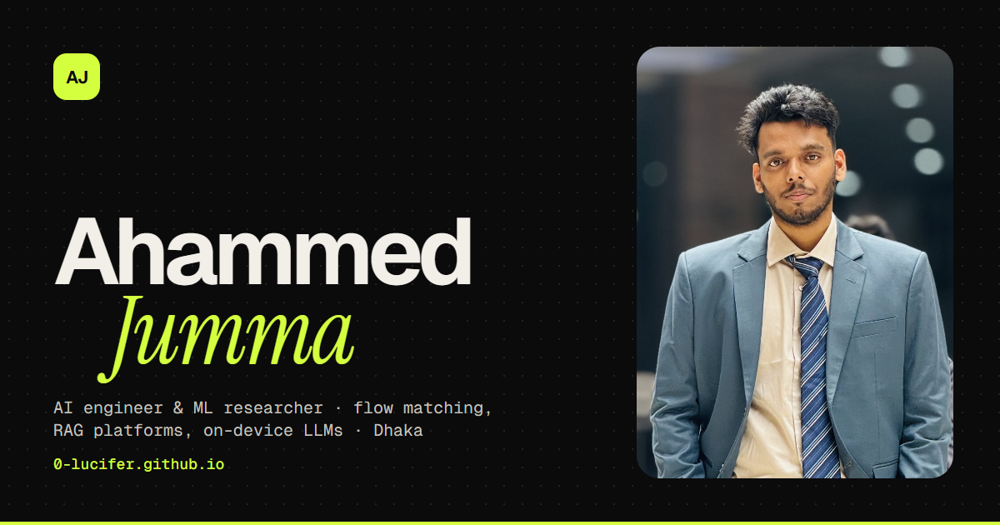

<a href="https://0-lucifer.github.io"></a>

# 0-lucifer.github.io

The personal portfolio of **Ahammed Jumma**, an AI engineer and ML researcher in Dhaka.

**→ Live at [0-lucifer.github.io](https://0-lucifer.github.io)** · [CV](https://0-lucifer.github.io/cv.html)

## What's on it

- **Research:** TDFlow (flow matching for glioma recurrence vs radiation necrosis) and CitizenLink (graph modelling of 5.13M citizens), each with a live visual. One shows noise flowing into anatomy; the other is a family graph you can hover to trace a lineage.
- **Selected work:** a pinned, horizontally scrolling gallery of seven projects. Each card opens a full case study.
- **Index:** every other project, filterable by area.
- **Experience, toolbox, education and contact.**
- **CV page:** printable, with a PDF download.

## How it's built

Plain HTML, CSS and JavaScript, with no build step and no framework.

| Piece | Used for |
|---|---|
| [GSAP 3.15](https://gsap.com) + ScrollTrigger + SplitText | text reveals, the pinned gallery, scroll-scrubbed copy, counters |
| [Lenis 1.3](https://lenis.darkroom.engineering) | smooth scrolling |
| Canvas 2D | the hero flow field and the flow-matching visual |
| Inline SVG | the platform diagram, route map and family graph |
| View Transitions API | theme switch reveal and page-to-page transitions |

The libraries are vendored in `assets/vendor/`, so the site does not depend on a CDN. Fonts are Geist, Geist Mono and Instrument Serif from Google Fonts.

It respects `prefers-reduced-motion`, works with JavaScript turned off, follows the system light or dark theme (with a manual toggle), and has no horizontal scrolling down to 320 px.

## Structure

```
index.html            the portfolio (case studies live in <template id="case-…"> blocks)
cv.html               printable CV
404.html              not-found page
assets/css/style.css  design tokens, components, responsive rules
assets/js/main.js     all interactions
assets/img/           portrait, wafer-map tiles, icons, social image
assets/vendor/        GSAP, ScrollTrigger, SplitText, Lenis
assets/Ahammed-Jumma-CV.pdf
```

## Run locally

```bash
python3 -m http.server 8000
# open http://localhost:8000
```

## Editing

- **A project card:** edit its `<article class="card">` in `index.html`, and the matching `<template id="case-…">` for the case study.
- **Another project in the index:** copy an `<li class="row">` and set `data-tags` to any of `ai`, `mobile`, `web` or `embedded`.
- **The CV:** edit `cv.html`, open it in Chrome or Edge, print to PDF (A4, no headers or footers), and save it as `assets/Ahammed-Jumma-CV.pdf`.

Pushing to `main` deploys through GitHub Pages.

---

© Ahammed Jumma. The text, photos and project write-ups are personal content. Please don't reuse them.
